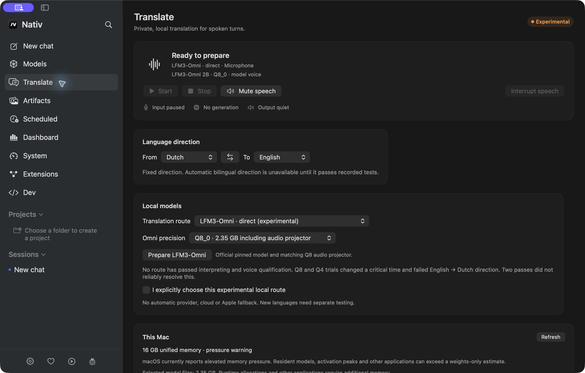
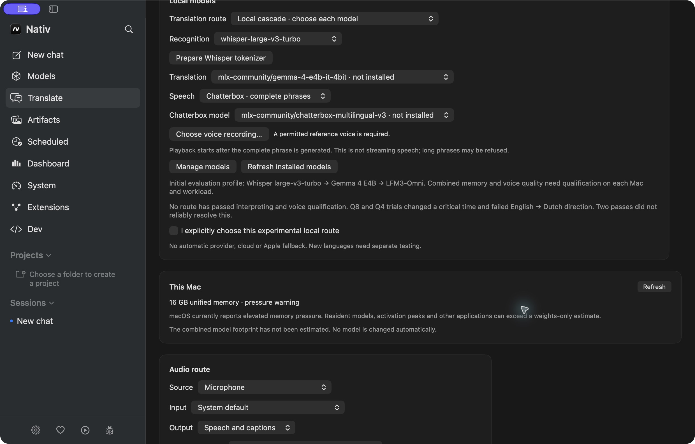
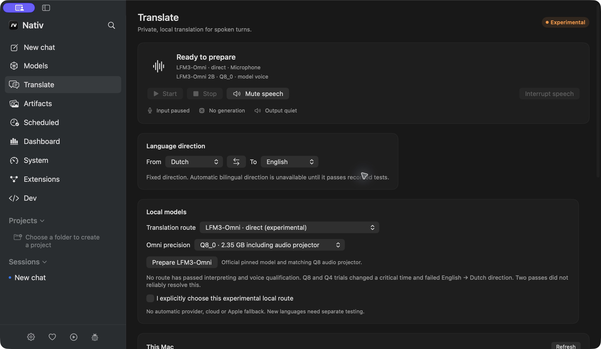

# Native UI-controle — 8 november 2026

De Apple Development-gesigneerde developmentbuild is daadwerkelijk geopend op de M5/16-GiB-Mac met macOS 26.6. De zichtbare app kwam uit de bronkopie onder `~/Library/Developer/NativLiveTranslationValidation/20261108-1352`; de canonical werkboom blijft de repository. De kopie vermijdt de Desktop-TCC-startblokkade zonder privacyinstellingen te wijzigen. Deze observatie bewijst geen microfoon-, model- of gesproken vertaalsessie.

## Waargenomen

- De first-party Translate-extension verschijnt tussen de bestaande extensions en gebruikt dezelfde zijbalk en paginarouting.
- Inschakelen en openen startte geen microfoon, helper of modeldownload. De gedeelde MLX-server die de bestaande onboarding startte, is via **Stop Server** gestopt.
- De hoofdroute is LFM3-Omni direct, Q8_0. Start blijft uit totdat de gebruiker expliciet de experimentele route kiest. De pagina meldt de werkelijk waargenomen tijd-/taalrichtingfouten.
- De pagina toont fysieke 16 GB RAM, actuele geheugendruk en een bestandsraming met de beperking dat dit geen runtimegeheugenmeting is.
- De cascade heeft afzonderlijke herkenning-, vertaling- en spraakkeuzes. Chatterbox toont volledige-frase-uitvoer en een referentiebestand; Apple toont uitsluitend handmatig te kiezen geïnstalleerde stemmen voor de doeltaal. Daarna is LFM3-Omni direct als route hersteld.
- De bron **System audio · separate stream** schakelt de uitvoer standaard naar **Captions**. Schermtoestemming wordt pas bij Start gevraagd; geen toestemming of capture is gestart.
- Overlayvoorkeur en de sneltoets Control + Option + T zijn zichtbaar. De pagina vermeldt expliciete Resume na slaap/vergrendeling en één gedeelde sessie.

## Grenzen en vervolgstappen

Dit zijn echte donkere-mode-screenshots van een idle developmentbuild, geen mockups of bewijs van vertaalresultaten. De kopie is gemaakt vóór de laatste baselinefixes voor CoreAI-reflectie en WebKit. De laatste bronwijziging geeft de generieke extension-schakelaar een toegankelijk label; dat label is in de vervolgcontrole van de definitieve build hieronder bevestigd.

Een poging om een tweede venster via het File-menu te openen liep vast op verouderde accessibility-elementen van de UI-automatisering. Gedeelde multi-windowstatus is daardoor niet visueel bewezen. De overlay tijdens spraak, vergelijking met actief dicteren, VoiceOver, lichte mode, Reduce Motion/Transparency, notch/externe schermen, sleep/lock/quit tijdens capture, echte audioapparaten en akoestische stoplatency blijven afzonderlijke praktijkgates. Er is geen privacytoestemming gewijzigd en geen gebruikersgesprek opgenomen.

## Controle van de definitieve developmentbuild

De opnieuw gebouwde en diep geverifieerde Apple Development-preview met ingebedde bronrevisie `e1cf3640ef066cf3bd7e1f149701c6294bf5a0f9` is daarna daadwerkelijk geopend. De oorspronkelijke donkere screenshots blijven eerdere observaties; onderstaande opname komt uit de finale build.

De accessibility-tree toont nu **Enable Audio** en **Enable Translate** voor de extension-schakelaars. Een tweede venster werd met Command+Shift+N geopend; Translate toonde dezelfde inactieve instellingen. Een wissel naar Engels → Nederlands in dat venster verscheen ook in het eerste venster nadat het tweede was gesloten. Daarna is Nederlands → Engels hersteld. Dit bevestigt gedeelde instellingen in idle-vensters, niet audio-concurrency tijdens een actieve sessie.

De eindtoestand is LFM3-Omni direct/Q8, microfoon als geselecteerde bron, speech + captions, experimentcheckbox uit, geen capture of model geladen. De bestaande algemene MLX-server is via **Stop Server** gestopt. Er is geen privacytoestemming via de UI aangevraagd of gewijzigd. De overige fysieke/audio-/VoiceOver-/overlaykwalificaties hierboven blijven open.

## Vervolgpreview na subprocesscorrectie

De nieuwe Make-build met ingebedde appcode `28cabb68f57e8ab5e01cb19eaf3c690d37c7349d` is geslaagd in `development-build-subprocess-final.log`. De Apple Development-signature is opnieuw deep/strict geverifieerd (`local-subprocess-final-signing.log`). De vorige eigen preview is netjes afgesloten; de nieuwe executable is gestart en de Translate-pagina is opnieuw zichtbaar waargenomen. `local-subprocess-final-launch.json` koppelt de executable, bundle-ID, revisie en controle aan elkaar.

Deze aanvullende controle toont direct/Q8, Nederlands→Engels, een uitgevinkte experimentele opt-in, gepauzeerde input, geen generatie en stille output. De algemene appserver is via de app gestopt. Prepare en Start zijn niet gebruikt; de pagina toont de actuele 16-GB-geheugenwaarschuwing. De eerdere screenshots, toegankelijke labels en gedeelde idle-instellingen betreffen de ongewijzigde UI-bron van `e1cf3640`; zij worden niet opnieuw als hardware- of actieve audiokwalificatie geteld. De subprocesscorrectie wijzigt geen Translate-UI of modelroute.
