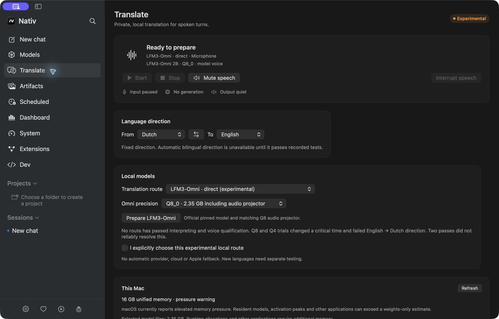
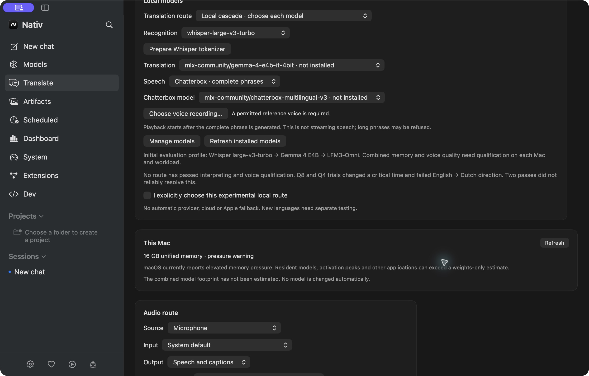

# Live Translate (fork preview)

See the [Dutch delivery report](../development/live-translation-delivery.md) for the delivered build, measured limits and remaining qualification gates.

This feature belongs to `CharafChnioune/nativ`, an independent fork of Nativ. It is
an experimental, local turn/phrase interpreter. No language pair or main voice is
human-qualified yet. Do not treat a working transport as proof of translation accuracy.

The current review source is `02925862`, a copy-only update after the runtime/catalog
behavior fixes in `5202fa1d`. The latest targeted review passed 17/17 native tests;
the Python suite passed 171 tests with one explicit opt-in skip (172 discovered).
**The final Make build succeeded in 41.199 seconds; Apple Development deep/strict
verification and the native UI inspection succeeded on `02925862`.** CI is evaluated
separately for the exact review HEAD through the
[PR checks](https://github.com/CharafChnioune/nativ/pull/1/checks). No green CI result
for a later HEAD is inferred. Older builds remain tied to their recorded revisions;
see the [acceptance matrix](../development/live-translation-acceptance.md).

## Build and run locally

Use Apple silicon, macOS 26+, Xcode with its Metal toolchain, CMake and XcodeGen.
The build prepares the pinned native helper and the separate Python runtime;
speech-model weights are downloaded only by explicit preparation.

Use a checkout of the reviewed commit outside Desktop/Documents, for example under
`~/Library/Developer/nativ-live-translation`. Build from that checkout with DerivedData
outside those protected folders too. Moving only an already-built `.app` is insufficient:
its debug library search paths can still point back into Desktop.

```sh
cd "$HOME/Library/Developer/nativ-live-translation"
make xcode-build XCODE_DERIVED_DATA="$HOME/Library/Developer/NativLiveTranslationDerivedData"
security find-identity -v -p codesigning
# Replace the placeholder with your existing Apple Development identity/hash.
CODE_SIGN_IDENTITY="<Apple Development identity or hash>" \
  ./scripts/sign_macos_debug.sh "$HOME/Library/Developer/NativLiveTranslationDerivedData/Build/Products/Debug/Nativ.app"
./scripts/open_macos_debug.sh "$HOME/Library/Developer/NativLiveTranslationDerivedData/Build/Products/Debug/Nativ.app"
```

This is the local signing/launch route that produced the visible native preview on the
reference Mac. It uses an existing unlocked Apple Development certificate; it creates no
certificate or distribution identity. The launcher verifies the isolated fork bundle and
only restarts that exact build. It does not replace the separately installed official Nativ.

An ad-hoc alternative exists as `make xcode-local-run`, but it did not reach a visible UI
on the reference Mac (AMFI -423), so it is not a verified substitute. The original Desktop
build also encountered privacy prompts and a launch stall through absolute debug paths;
a source snapshot and rebuilt product outside Desktop resolved that launch obstacle.
No macOS privacy settings were changed. The fork now has its own Sparkle Keychain
signing account, committed public key and configured stable/preview feed identities.
Signed archive/feed verification has been exercised; private-key export and release
publication were not performed. Developer ID, notarization, protected CI credentials,
published updates and a real old-to-new installation remain separate distribution
gates. GitHub OAuth is optional, not an update prerequisite. See the
[Sparkle evidence](../development/sparkle-signature-evidence.json).

## Start a session

1. Enable **Translate** in Extensions, then open its sidebar page. Enabling/opening
   only installs the UI and shortcut: it does not start capture, load a model or download weights.
2. Choose a fixed source/target direction. Dutch → English is initially displayed;
   swap explicitly for the other direction. The cascade also offers experimental
   automatic direction within the selected pair after explicit opt-in. Short, mixed
   or ambiguous text stops speech instead of guessing. This option has not passed
   a separate human recording-based qualification.
3. Choose **LFM3-Omni direct** or **LFM3-Omni two passes**, precision and output mode.
   Press **Prepare LFM3-Omni** to explicitly download and verify the exact weights plus
   matching audio projector. Progress represents downloaded bytes; verification is not a fake percentage.
4. Read the measured limitations and explicitly choose the experimental route.
   Select input/output devices and the headphones option only when actually using headphones.
5. Press **Start**. Pause/Resume, Stop, Mute and Interrupt Speech are separate actions.
   The default global toggle is Control+Option+T and can be changed in the page.

The implementation shares one app-scoped session across windows and the compact overlay.
Its lifecycle handlers stop capture on sleep, lock, disable, removal and quit; waking requires
explicit Resume. Multi-window and sleep/lock behavior still need physical acceptance tests.
A route, language, model or device change requires Resume with a fresh context.
Changing the overlay or shortcut alone preserves the session.

The preferred evaluation order remains direct Omni → same Omni in two passes →
explicitly chosen alternative. Neither tested Omni mode passed NL/EN quality checks,
so there is no qualified automatic default. The same resident model serves both passes;
the realtime socket closes before `/tts` acquires the single runtime slot.

## Audio and privacy

Microphone and system audio are separate sources. System audio uses ScreenCaptureKit,
excludes Nativ's output and the microphone, and defaults to captions. Speech output
for system audio requires explicitly selected headphones. Virtual microphone routing
is outside this version.

Headphones allow ordered capture while a response generates/plays. At most one turn
is active and one waits; excess input is marked incomplete, not silently omitted.
Speaker mode pauses the microphone while translating/speaking to avoid feedback.
It is a half-duplex fallback, not acoustic echo cancellation or full-duplex interpreting.
Interrupt Speech invalidates old output and resets context; ordinary new speech does
not automatically interrupt the previous response.

Audio remains in memory. There is no automatic recording, conversation history,
clipboard insertion or export. Copy/Export saves only explicitly completed text on request.
The UI retains at most 200 turns. A complete retry segment expires after 30 seconds.
Provider errors and missed input are visible; repeat incomplete speech instead of assuming
that the transcript is continuous. Diagnostics contain timings/versions, not conversation content.

Model/tokenizer preparation needs network access. Inference uses authenticated local
loopback services. The translation adapters reject off-device endpoints and redirects.
No automatic cloud or Apple fallback is configured.

## Other local models and voices

The cascade independently selects recognition, translation and speech. The initial
profile is Whisper large-v3-turbo → Gemma 4 E4B → LFM3-Omni TTS. Prepare MLX model
weights in Models and use **Prepare Whisper tokenizer** for the pinned processor files
missing from the official MLX conversion. Preparation does not change the source snapshot.

On the reference Mac, the normal app cache now contains the already downloaded,
pinned Whisper, Gemma E4B and Omni Q8/projector artifacts. Existing model directories
were not replaced. In the final native UI, **Prepare LFM3-Omni** verified the model
artifacts and **Prepare Whisper tokenizer** completed successfully; all nine processor
hashes were checked again, with unchanged source weights/config. The cascade menus
found Whisper and Gemma without missing-model labels. This was preparation only,
without inference or capture; see the [cache receipt](../development/translation-final-app-cache-evidence.json).

The owned sequential cascade has now completed two synthetic NL/EN turns on the
16 GiB reference Mac in each of two separate native tests. The content-preserving
run retained correct source/target examples and actual PCM; first received audio
took 7.215/6.840 seconds including sequential loading. Earlier load, hashing and
swap-guard failures remain in the evidence. These results do not qualify every
component combination or guarantee model fit on all 16 GB machines.

Choose sequential release or explicit resident operation according to the selected
models and available resources. Nativ reads actual memory and pressure on 16 GB,
128 GB and other Macs. Weight-size planning is heuristic and cannot predict all
activation peaks or other apps' needs. No model is replaced silently; a 16 GB
measurement does not qualify untested 128 GB hardware. Recognition, generative
translation and speech choices have separate task/language limitations, including
variant-specific Whisper language support. See the
[stage catalog](../development/translation-stage-catalog.md).

Chatterbox is optional and generates a complete phrase before playback. It is not a
streaming provider. Its multilingual model, tokenizer and a permitted reference recording
must be available locally. A bounded batch result is distinct from the streaming transport
budget; long phrases can be refused. Target language support is checked for the chosen
model. Explicit preparation now installs the pinned auxiliary S3/Cangjie assets,
and an optional CC0 Thorsten stock reference is available. That reference is German
and does not qualify Dutch/English pronunciation or voice quality. Missing local
prerequisites remain visible; synthesis and the S3 conversion-license provenance
still have separate qualification/distribution limits. See
[speech preparation and provenance](../development/translation-speech-provenance.md).

Apple system voices are an explicitly selected extra speech renderer within the cascade.
They are never the preferred translation route or an automatic fallback. Installed voice
languages and voices vary by Mac; an explicit matching voice is required.

## Evidence and limits

LFM3 speech and text language lists differ: Dutch is documented for speech, but is absent
from the published text list. Recognition, text translation and target speech are tracked
separately. Documented availability does not establish tested or qualified interpreting.

The new [Q8/Q4 production-prompt matrix](../development/translation-omni-production.md)
returned text in the requested target language but retained critical semantic errors:
“half vier” became “half past four” or “half four”; booking requests changed into
“Bekijk”, “Vul” or “Vergeten”, and Q4 also changed Thursday into Tuesday. Without
a source transcript, the Omni output-language guard cannot compare these details
against the spoken source. Neither route is a qualified default or fallback.

The later [production endurance run](../development/translation-production-endurance.md)
completed 160 warm transport turns out of 161 attempts and ten process-cold starts,
then aborted after 922.103 seconds of warm testing (15m22s) on the unchanged +1024 MiB global-swap
guard. It reached none of the five planned cancellation trials. All eleven owned
helper processes were absent after cleanup. The 30-minute requirement was not met.
There are only 80 completed observations per mode and 40 per mode/direction, so no
p50/p95 is reported. Observed median first network PCM was 232 ms direct and
1620 ms for two passes; this excludes audible output and native app latency.
All 80 completed NL→EN outputs retained the wrong clock time, and all 80 EN→NL
outputs changed the booking action. Technical completion is not semantic success.

On an M3 Max (128 GB), a later Q8 run with the same production contract completed
the 30-minute warm phase technically: 380 turns (190 per mode), no errors, ten
cold starts ready in 0.45–0.48 s and five cancellations, without swap growth. Over
loopback, direct first audio had p50 111 ms / p95 127 ms and two-pass first audio
p50 1.28 s / p95 1.34 s. Every NL turn still said “half past four” and the output
guard accepted all 380 turns, so this does not qualify LFM3 either. See the
[M3 acceptance evidence](../development/live-translation-acceptance.md#m3-max-productiepromptmatrix-10-november-2026).

The [native cascade content test](../development/translation-host-cascade-content-evidence.json)
retained two correct text examples: “half past three, not four o'clock” and
“Boek twee plaatsen voor vrijdag, niet voor donderdag”, with finite nonzero PCM.
After MP3 previews of these two outputs, the owner replied “goed”. This is a
preliminary positive voice impression, not a structured spoken-content,
naturalness, prosody or main-voice qualification. Earlier failed cascade attempts
and the older 38-turn aborted endurance run remain separate historical evidence.

The 60 original fixture texts in
[`scripts/benchmarks/live_translation`](../../scripts/benchmarks/live_translation/README.md)
are ready for new recordings by the owner/tester. Each direction needs at least 30
rated turns, meaning and actual spoken-output review, critical number/negation
checks, naturalness, prosody and emotional intent ratings, and formal owner
acceptance of the main voice.

The earlier native dark page shown below was opened without capture or preparation. It showed LFM3
direct/Q8 with experimental consent unchecked; the cascade exposed independent component
menus, Chatterbox's full-phrase/reference requirement and an explicit Apple voice choice.
Selecting system audio defaulted to captions without requesting permission or starting capture.
The LFM3 direct choice was restored afterward.





The [UI inspection](../development/live-translation-ui.md) records the scenarios and
limitations of these historical images. The older `e1cf3640` validation passed
1802 logical cases (1794 passed, eight explicit opt-in skips), and its signed preview
visibly opened. The later full native continuation on the `f2f79ccf` inputs passed
1860 logical cases (1852 passed, eight explicit skips). These counts remain
separate and do not qualify the latest source or any model/voice.

The final signed preview `02925862` was actually opened and inspected. It showed
independent cascade components, sequential/resident choices, provider limitations
and the actual measurement summary. Both preparation buttons verified the existing
normal-cache assets. A second window showed the same prepared status and choices;
swapping direction there updated the first window. The direction was restored to
Dutch → English and the second window was closed.

The app was left **open and idle on LFM3 direct/Q8_0/Dutch → English**, with
experimental consent and the headphones option off, no active microphone and its
own chatserver stopped through the UI. No Translate inference, capture or audio
playback started during this inspection. These observations establish preparation
and shared idle state, not active sessions, overlay/multiple screens, VoiceOver,
sleep/lock, acoustic or 128 GB qualification. Screenshots were displayed inline;
no new exported PNG is claimed. See the
[final bundle/UI receipt](../development/translation-final-reviewed-bundle-evidence.json).
The earlier `13ecd853` preview and its then-missing Gemma inventory remain in the
[historical receipt](../development/translation-continuation-bundle-evidence.json);
that older inventory is not the current normal cache.

Subsequent [review regressions](../development/translation-review-regressions-evidence.json)
passed 17/17 targeted native cases and 171 Python tests with one explicit skip.
They cover owned child/supervisor shutdown, complete listener-port parsing and
conservative Whisper metadata/language claims; the strengthened gate requires
18 classes and 12 critical cases. The new preview source `02925862` includes a
copy-only status update after those behavior fixes. Its final Make build and signing are now verified, followed by the native idle UI
inspection described above. Exact-head CI is evaluated separately through PR checks;
no earlier green CI result is assigned to a later revision.
[Draft PR #1](https://github.com/CharafChnioune/nativ/pull/1) remains the review point.

The [acceptance matrix](../development/live-translation-acceptance.md) preserves
all earlier evidence and the remaining qualification/distribution gates. See also
[runtime evidence](../development/translation-runtime.md),
[repository audit](../development/live-translation-audit.md) and
[fork maintenance](../development/fork-maintenance.md). Performance targets remain
targets until measured, not promises about the present preview.
